# CafeFlow

ASP.NET Core MVC (.NET 8) ile geliştirilmiş, tasarım deseni tabanlı kafe sipariş ve yönetim sistemi. Solution ve proje adları `CafeOrder.*` şeklindedir; sitede görünen marka **CafeFlow**'dur.

> M&Y Eğitim Full Stack .NET programı kapsamında hazırlanan **CafeFlow** case projesidir.

Müşteriler giriş yapmadan online teslimat, gel-al veya masadaki QR kod ile sipariş verir. Yönetici giriş yaparak menüyü, masaları ve siparişleri yönetir; yeni siparişler ve durum değişiklikleri panelde bildirim olarak görünür. Gerçek ödeme, kurye ve SMS entegrasyonu kapsam dışıdır.

Sitenin tamamı (müşteri sayfaları, admin paneli, hata ve bildirim mesajları, örnek menü) **Türkçedir**. Uygulamada global bir kültür ayarı yoktur: para ve tarih yardımcı metotlarda açıkça Türkçe biçimlenir (`₺1.234,50`, `13 Kas 2026, 10:30`), formdan gelen ondalık sayılar ise `185,50` veya `185.50` yazılsa da doğru okunur. Böylece site sunucunun dili ne olursa olsun aynı görünür.

Kod okumaya yeni başlayanlar için bütün kodu satır satır anlatan rehber: **[docs/kod-rehberi](docs/kod-rehberi/00-BASLA.md)**

## Özellikler

### Müşteri tarafı (herkese açık)

- **Ana Sayfa:** kategoriler ve öne çıkan (rozetli) ürünler veritabanından gelir
- **Ürünler:** arama ve kategori filtresi; ikisi de sunucuda uygulanır (`/products?category=pastalar&q=latte`)
- **Ürün Detay:** açıklama, fiyat; boyut, süt, ekstra shot, krema ve şurup seçimi; aynı kategoriden diğer ürünler
- **Sepet:** Session'da tutulur; teslimat, gel-al veya QR ile masa siparişi; bütün tutarları sunucu hesaplar
- **Sipariş onayı:** sipariş numarası ve özet

Bütün sayfalar diğer MVC projelerindeki gibi çalışır: controller veriyi **model** olarak view'a verir, Razor (`@model`, `@foreach`) sayfayı sunucuda çizer, işlemler form (POST) ile gönderilir. JavaScript hiçbir işlem yapmaz: veri getirmez, form göndermez, fiyat hesaplamaz. Sadece görsel işler içindir (menüyü açıp kapama, mesaj kutusunu gizleme). Silme gibi işlemlerden önce tarayıcının standart onay kutusu (`confirm`) çıkar.

### Admin paneli (`/admin`, giriş gerekir)

| Sayfa | Ne yapar |
|---|---|
| Dashboard | Bugünkü sipariş ve ciro, açık siparişler, son 7 günün cirosu, son siparişler, en çok satanlar, durumlara göre sipariş sayısı |
| Siparişler | Durum ve kanal filtresi, arama, sayfalama, detay, durum güncelleme |
| Kategoriler | Listele, ekle, düzenle, aktif/pasif yap, sil |
| Ürünler | Kategori filtresi, ada göre arama, ekle, düzenle, aktif/pasif yap, sil |
| Masalar | Ekle, düzenle, her masanın QR kodu ve açtığı adres listede görünür, yeni QR kodu üret, aktif/pasif yap, sil |
| Müşteriler | Sipariş sayısı, toplam harcama, son sipariş; ad veya telefonla arama (salt okunur) |
| Bildirimler | Mutfak, kasa ve admin mesajları; hedef ve okunmamış filtresi, okundu işaretleme |
| Hesabım | Profil bilgisi, şifre değiştirme, çıkış |

### Giriş ve güvenlik (ASP.NET Core Identity)

- `/admin` altındaki her sayfa yalnızca **Admin** rolündeki kullanıcıya açıktır. Giriş yapmamış kişi `/admin/login` sayfasına gönderilir; giriş yapınca açmak istediği sayfaya döner.
- Oturum **30 gün** açık kalır ve panel kullanıldıkça süresi yenilenir. Tarayıcı kapatılıp açılsa da tekrar giriş gerekmez.
- 5 hatalı şifre denemesinden sonra hesap 5 dakika kilitlenir.
- Şifreler veritabanında düz metin olarak değil, özet (hash) olarak saklanır.
- Bütün formlar antiforgery token ile korunur; giriş sonrası yalnızca site içi adreslere yönlendirme yapılır.

## Teknolojiler

- .NET 8, ASP.NET Core MVC, Razor
- Entity Framework Core 8, SQL Server (Express veya LocalDB)
- AutoMapper 12.0.1 (Entity ↔ DTO eşlemesi; tablo başına bir `Profile` sınıfı)
- ASP.NET Core Identity (giriş, rol, şifre özeti, kilitleme)
- Session (müşteri sepeti)
- Bootstrap 5, verilen CafeFlow HTML/CSS/JS tasarımı

## Mimari

Klasik N katmanlı yapı kullanılır. Bağımlılıklar yukarıdan aşağı akar.

```text
CafeOrder.WebUI           Controller'lar, Razor sayfaları, Session sepeti (CartSession),
                          Identity ayarları; Program.cs katmanların kayıt metotlarını çağırır
       ↓
CafeOrder.BusinessLayer   Services (ICategoryService / CategoryService ...), 6 tasarım deseni,
                          AutoMapper Profile'ları (Mapping/*Mappings), BusinessException,
                          DI kayıtları (BusinessServiceRegistration → AddBusinessLayer)
       ↓
CafeOrder.DataAccessLayer GenericRepository<T> + tablo başına bir repository, Unit of Work,
                          DbContext, tablo ayarları, migration, başlangıç verileri,
                          DI kayıtları (DataAccessServiceRegistration → AddDataAccessLayer)
       ↓
CafeOrder.EntityLayer     Entity sınıfları (AppUser dahil) ve enum'lar

CafeOrder.DtoLayer        Ekran ile servis arasında taşınan veri: Result / Create / Update DTO'ları
                          (WebUI ve BusinessLayer kullanır; sadece EntityLayer'daki enum'ları görür)
```

Akış her yerde aynı:

1. Controller servisi çağırır; formdan gelen veri **Create/Update DTO** olarak gider.
2. Servis DTO'yu AutoMapper ile **entity**'ye çevirir, kuralları uygular (hata varsa `BusinessException`), repository'ye ekler ve `IUnitOfWork.SaveChangesAsync()` ile kaydeder.
3. Okurken servis repository'nin isimli bir metodunu çağırır (`GetMenuAsync`, `GetWithDetailsAsync` ...), gelen entity'yi AutoMapper ile **Result DTO**'ya çevirip döner. Sorgular (Include, Where, sayfalama) repository'de, SQL'de çalışır.
4. Controller DTO'yu view'a verir (`return View(products)`); view `@model List<ResultProductDto>` ile çizer.

Entity'ler WebUI'a hiç çıkmaz (Identity'deki `AppUser` hariç). Tasarım desenleri BusinessLayer içinde entity üzerinde çalışır. Servisler ve desen sınıfları birbirini `new` ile oluşturmaz; hepsi constructor'dan, DI ile gelir.

| DTO | Ne zaman |
|---|---|
| `ResultXDto` | Listeleme ve detay ekranları (ör. `ResultProductDto.CategoryName`) |
| `CreateXDto` | Yeni kayıt |
| `UpdateXDto` | Düzenleme formu; form sayfası bu DTO ile açılır, `Id = 0` ise controller onu `CreateXDto`'ya çevirir |
| `CartItemDto` | Session'daki sepet satırı |
| `CreateOrderDto` | Sepet sayfasındaki sipariş formu (ad, telefon, adres, not, saat) |

### Kodu okumaya nereden başlamalı?

| Sıra | Dosya | Neden |
|---|---|---|
| 1 | `CafeOrder.WebUI/Program.cs` → `BusinessLayer/BusinessServiceRegistration.cs`, `DataAccessLayer/DataAccessServiceRegistration.cs` | Hangi interface için hangi sınıfın kullanıldığı (DI kayıtları) |
| 2 | `CafeOrder.DataAccessLayer/Repositories/GenericRepositories/GenericRepository.cs` + `UnitOfWork/` | Bütün tabloların ortak veritabanı işlemleri ve tek kayıt |
| 3 | `CafeOrder.BusinessLayer/Mapping/*Mappings.cs` (`CategoryMappings`, `ProductMappings`, `OrderMappings` ...) | Hangi entity hangi DTO'ya nasıl çevrilir (AutoMapper Profile) |
| 4 | `CafeOrder.BusinessLayer/Services/Products/ProductService.cs` | Basit bir servis: DTO alır/döner, kurallar, kaydetme |
| 5 | `CafeOrder.WebUI/Controllers/ProductsController.cs` + `Views/Products/Index.cshtml` | Verinin sayfaya gelişi |
| 6 | `CafeOrder.WebUI/Controllers/CartController.cs` | Session sepeti ve sipariş verme |
| 7 | `CafeOrder.BusinessLayer/Services/Orders/OrderService.cs` + `OrderPricingService.cs` | 6 desenin sırayla çalıştığı yer |

### Klasörler

```text
CafeOrder.EntityLayer/       Entities (Product, Order ...), Enums (OrderStatus, OrderChannel ...)
CafeOrder.DataAccessLayer/   Context (DbContext, SeedData), Repositories/<Tablo>, UnitOfWork, Migrations
CafeOrder.DtoLayer/          Dtos/<Tablo>Dtos (ResultXDto, CreateXDto, UpdateXDto, CartItemDto, CreateOrderDto)
CafeOrder.BusinessLayer/     Services/<Tablo>, Services/Dashboard, Mapping (AutoMapper Profile'ları), Exceptions
                             Pricing (Decorator), Pricing/Fees (Strategy), Validation (Chain),
                             Creation (Factory Method), States (State), Events (Observer)
CafeOrder.WebUI/             Controllers, Views, Cart (Session), ViewComponents,
                             Areas/Admin (admin paneli), Identity (giriş), wwwroot (CSS, JS)
```

## Bir Sipariş Nasıl İşlenir?

Müşteri sepette **Siparişi Ver** düğmesine bastığında sırasıyla şunlar çalışır:

```text
Views/Cart/Index.cshtml            form → POST /cart/checkout (CreateOrderDto)
  ↓
CartController.Checkout            sipariş türünü ve sepeti Session'dan okur
  ↓
CartService.CheckoutAsync → OrderService.PlaceOrderAsync
  1. AutoMapper                    CreateOrderDto → Order
  2. Masa / müşteri                QR koduyla masa, telefonla kayıtlı müşteri bulunur
  3. Factory Method                Delivery / Pickup / TableOrderCreator siparişi kurar
  4. Decorator + Strategy          OrderPricingService: birim fiyatlar, ara toplam, teslimat ücreti
  5. Chain of Responsibility       Product → Quantity → ChannelInfo → OrderAmount kontrolleri
  6. Observer                      Kitchen / Cashier / AdminObserver bildirimleri ekler
  7. Unit of Work                  sipariş + kalemler + ilk durum + bildirimler tek transaction'da kaydedilir
  ↓
CartController                     sepeti boşaltır → /cart/confirmation/{orderNo}
```

Kurallardan biri tutmazsa servis `BusinessException` fırlatır, sipariş kaydedilmez ve sepet sayfası yazılanlar kaybolmadan hata mesajıyla tekrar açılır.

Admin sipariş detayında bir durum düğmesine bastığında: `OrdersController.ChangeStatus` → `OrderService.ChangeStatusAsync` → **State** (geçiş izinli mi?) → durum geçmişi → **Observer** (bildirim) → tek kayıt.

## Tasarım Desenleri

| Desen | Kullanıldığı yer | Çözdüğü iş |
|---|---|---|
| Decorator | `BusinessLayer/Pricing` | Boyut, süt, shot, krema ve şurup seçeneklerini ürün fiyatına ekler |
| Strategy | `BusinessLayer/Pricing/Fees` | Teslimat, gel-al ve masa için farklı ücret kuralları uygular |
| Chain of Responsibility | `BusinessLayer/Validation` | Ürün, adet, kanal bilgisi ve tutar kontrollerini sırayla çalıştırır |
| Factory Method | `BusinessLayer/Creation` | Siparişi kanala göre oluşturur |
| State | `BusinessLayer/States` | Sipariş durumları arasında yalnızca izinli geçişlere izin verir |
| Observer | `BusinessLayer/Events` | Sipariş olaylarını mutfak, kasa ve admin'e bildirir; admin bildirimleri paneldeki zilde görünür |

Her desenin amacı, kullanılan sınıflar, tetiklendiği iş akışı ve test edilen senaryolar: **[docs/DESIGN_PATTERNS.md](docs/DESIGN_PATTERNS.md)**

## İş Kuralları

**Sipariş**

- Fiyatlar ve toplamlar her zaman sunucuda hesaplanır; tarayıcıdan gelen fiyat kullanılmaz.
- Teslimat ücreti 30 ₺'dir; 600 ₺ ve üzerindeki siparişte ücretsizdir. Gel-al ve masa siparişinden ücret alınmaz. Rakamlar `CafeOrder.WebUI/appsettings.json` → `Pricing` bölümündedir.
- Teslimat için sipariş tutarı en az 100 ₺ olmalıdır.
- Her sipariş satırında adet 1 ile 20 arasında olmalıdır.
- QR kodu veritabanındaki **aktif** bir masayla eşleşmelidir; müşteri masa numarası yazamaz.
- Aynı ürünün farklı seçenekleri ayrı sipariş kalemi olarak saklanır.
- Sipariş kalemleri ürün adı ve fiyatının o anki kopyasını tutar; ürün sonradan değişse de eski sipariş bozulmaz.
- Sipariş, kalemleri, ilk durum kaydı ve bildirimleri tek transaction'da yazılır (ya hepsi ya hiçbiri).
- Durum akışı: Alındı → Hazırlanıyor → Hazır → Teslim Edildi. İptal yalnızca Alındı ve Hazırlanıyor durumlarından yapılabilir.

**Yönetim**

- Ürünü olan kategori silinemez. Pasif kategorinin ürünleri menüde görünmez.
- Geçmiş siparişlerde geçen ürün veya masa silinemez; bunun yerine pasif yapılır.
- Ürün fiyatı 0'dan büyük ve en fazla 10.000 ₺ olur; rozet yalnızca Çok Satan, Yeni, Popüler veya Şefin Seçimi olabilir.
- Masa numarası benzersizdir. QR kodu `CF-T07-ABC123` biçiminde rastgele üretilir. Masa numarası değişince veya "yeni QR" istenince eski kod çalışmaz.

## Kurulum

**Gereksinimler**

- .NET 8 ile derleme yapabilen .NET SDK
- SQL Server Express veya LocalDB (Visual Studio ile birlikte kurulabilir)

**1. Projeyi indirin**

```bash
git clone https://github.com/KorayhanAvcu/CafeFlow.git
cd CafeFlow
```

**Bağlantı adresini kendi sunucunuza göre ayarlayın**

`CafeOrder.WebUI/appsettings.json` → `ConnectionStrings:DefaultConnection`. Repodaki değer geliştiricinin bilgisayarındaki SQL Server Express içindir:

```json
"DefaultConnection": "Server=KORAYHAN\\SQLEXPRESS;Database=CafeOrderDb;Trusted_Connection=True;TrustServerCertificate=True"
```

`Server=` kısmını kendi sunucu adınızla değiştirin (ör. `.\\SQLEXPRESS` veya LocalDB için `(localdb)\\MSSQLLocalDB`).

Repodaki dosyayı değiştirmek istemezseniz bağlantı adresini yalnızca kendi bilgisayarınızda geçerli olacak şekilde User Secrets'a yazabilirsiniz (appsettings.json'daki değerin yerine geçer):

```bash
dotnet user-secrets set "ConnectionStrings:DefaultConnection" "Server=.\SQLEXPRESS;Database=CafeOrderDb;Trusted_Connection=True;TrustServerCertificate=True" --project CafeOrder.WebUI
```

**2. Admin şifresini belirleyin (bir kez)**

Şifre güvenlik için repoda tutulmaz; bilgisayarınızdaki **User Secrets** içinde durur. Uygulamayı ilk kez çalıştırmadan önce belirleyin:

```bash
dotnet user-secrets set "AdminAccount:Password" "Sifreniz123!" --project CafeOrder.WebUI
```

Visual Studio'da aynı iş `CafeOrder.WebUI` projesine sağ tık → **Manage User Secrets** ile yapılır. Şifre en az 8 karakter olmalı; büyük harf, küçük harf, rakam ve sembol içermelidir. Admin e-postası ve adı `CafeOrder.WebUI/appsettings.Development.json` içindeki `AdminAccount` bölümündedir (varsayılan e-posta: `admin@cafeflow.test`).

**3. Çalıştırın**

```bash
dotnet run --project CafeOrder.WebUI
```

Visual Studio'da `CafeOrder.slnx` dosyasını açın, `CafeOrder.WebUI` projesini başlangıç projesi yapın ve **F5** veya **Ctrl+F5** ile çalıştırın.

İlk açılışta uygulama:

1. `CafeOrderDb` veritabanını oluşturur ve migration'ları uygular,
2. örnek verileri ekler (bir kez; sonraki açılışlarda tekrar eklemez),
3. Admin rolünü ve hiç admin yoksa ilk admin hesabını oluşturur.

**4. Admin paneline girin**

`/admin/login` adresinden e-posta ve belirlediğiniz şifreyle girin. Şifreyi daha sonra **Hesabım** (`/admin/account`) sayfasından değiştirebilirsiniz. Şifre belirlenmemişse hesap oluşturulmaz ve uygulama günlüğe bir uyarı yazar.

**Bağlantı ve veritabanı**

Veritabanı şeması EF Core migration dosyalarıyla oluşur (`CafeOrder.DataAccessLayer/Migrations`); uygulama açılırken eksik migration'ları kendisi uygular.

Aynı şema düz SQL olarak da repodadır: [`database/CafeOrderDb_schema.sql`](database/CafeOrderDb_schema.sql). Bu dosya bütün migration'lardan üretilmiştir ve tekrar çalıştırılabilir (idempotent). Migration değişince yeniden üretmek için:

```bash
dotnet ef migrations script --idempotent --project CafeOrder.DataAccessLayer --startup-project CafeOrder.WebUI -o database/CafeOrderDb_schema.sql
```

LocalDB kullanıyorsanız ve açılmazsa ("Local Database Runtime error") şu iki komutu deneyin, olmazsa bilgisayarı yeniden başlatın:

```bash
sqllocaldb stop MSSQLLocalDB -k
```

```bash
sqllocaldb start MSSQLLocalDB
```

## Adresler

| Sayfa | Adres |
|---|---|
| Ana Sayfa | `/` |
| Ürünler | `/products` (kategori için `/products?category=pastalar`) |
| Ürün Detay | `/products/7` |
| Sepet | `/cart` |
| Masa 7 QR'ı | `/cart?qr=CF-T07-GUL` |
| Masa 12 QR'ı | `/cart?qr=CF-T12-SEFTALI` |
| Admin: Giriş | `/admin/login` |
| Admin: Dashboard | `/admin` |
| Admin: Siparişler | `/admin/orders` |
| Admin: Kategoriler | `/admin/categories` |
| Admin: Ürünler | `/admin/products` |
| Admin: Masalar | `/admin/tables` |
| Admin: Müşteriler | `/admin/customers` |
| Admin: Bildirimler | `/admin/notifications` |
| Admin: Hesabım | `/admin/account` |

## Örnek Veriler

| Veri | Adet | Detay |
|---|---|---|
| Kategori | 8 | 7 aktif, 1 pasif |
| Ürün | 20 | 7 tanesi özelleştirilebilir |
| Ürün seçeneği | 10 | Boyut, süt, ekstra shot, krema, şurup |
| Masa | 2 | `CF-T07-GUL` (Masa 7), `CF-T12-SEFTALI` (Masa 12) |
| Admin hesabı | 1 | E-posta `appsettings.Development.json`'dan, şifre User Secrets'tan |

Yukarıdakiler uygulama ilk açıldığında otomatik eklenir. Dashboard, sipariş listesi, filtreler ve bildirimler dolu görünsün diye **örnek siparişler** ayrı bir SQL scriptindedir: [`database/CafeOrderDb_sample_orders.sql`](database/CafeOrderDb_sample_orders.sql). Uygulamayı bir kez çalıştırdıktan sonra:

```bash
sqlcmd -S .\SQLEXPRESS -d CafeOrderDb -E -I -f 65001 -i database/CafeOrderDb_sample_orders.sql
```

| Veri | Adet | Detay |
|---|---|---|
| Müşteri | 5 | Ayşe Yılmaz, Mehmet Demir, Zeynep Kaya, Ali Vural, Can Öztürk |
| Sipariş | 11 | 4 teslimat, 4 gel-al, 3 masa (Masa 7 ve 12); son 7 güne yayılır |
| Durumlar | Hepsi | Alındı, Hazırlanıyor, Hazır, Teslim Edildi ve iki iptal (Alındı'dan ve Hazırlanıyor'dan) |
| Durum geçmişi ve bildirimler | Her sipariş için | Uygulamanın yazdığı kayıtlarla aynı biçimde |

Fiyatlar uygulama kurallarıyla aynı hesaplanmıştır. Örneğin `CF-DEMO0001`: Vanilyalı Latte Büyük + Yulaf Sütü + Shot 225 ₺ × 2, aynı ürün Küçük + Vanilya Şurubu 170 ₺ (ayrı kalem), Tereyağlı Kruvasan 95 ₺; ara toplam 715 ₺ olduğu için teslimat ücretsiz. Script tekrar çalıştırılırsa hiçbir şey eklemez.

## Ekran Görüntüleri

Bütün görüntüler [`docs/screenshots`](docs/screenshots) klasöründedir.

| Müşteri | Admin |
|---|---|
| 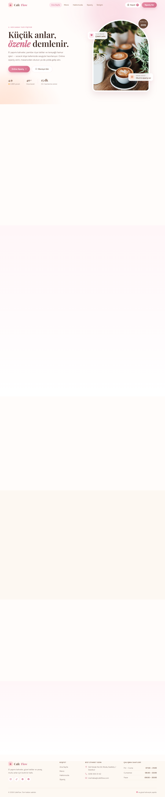 | 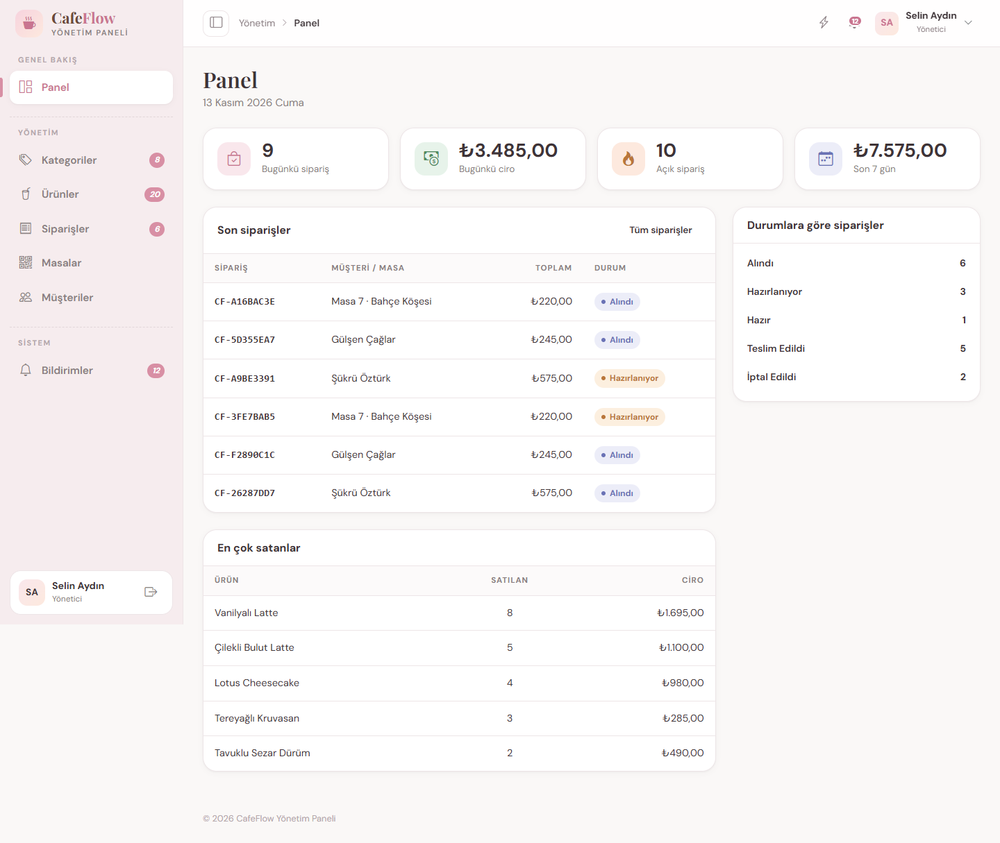 |
| 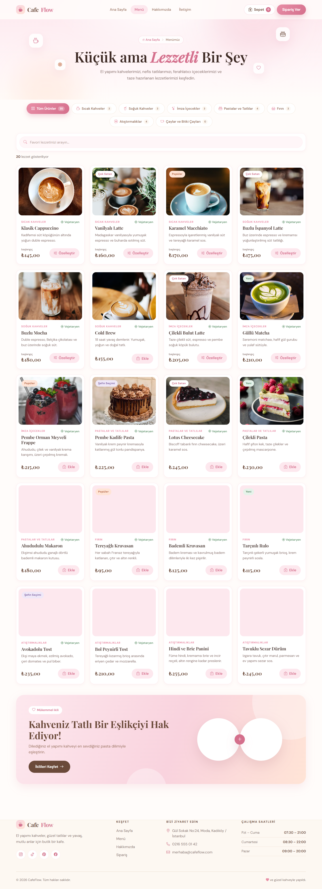 | 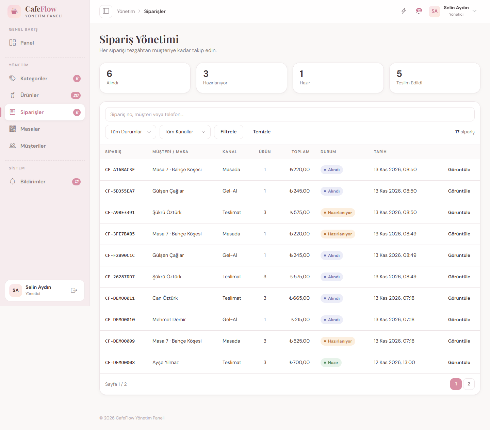 |
| 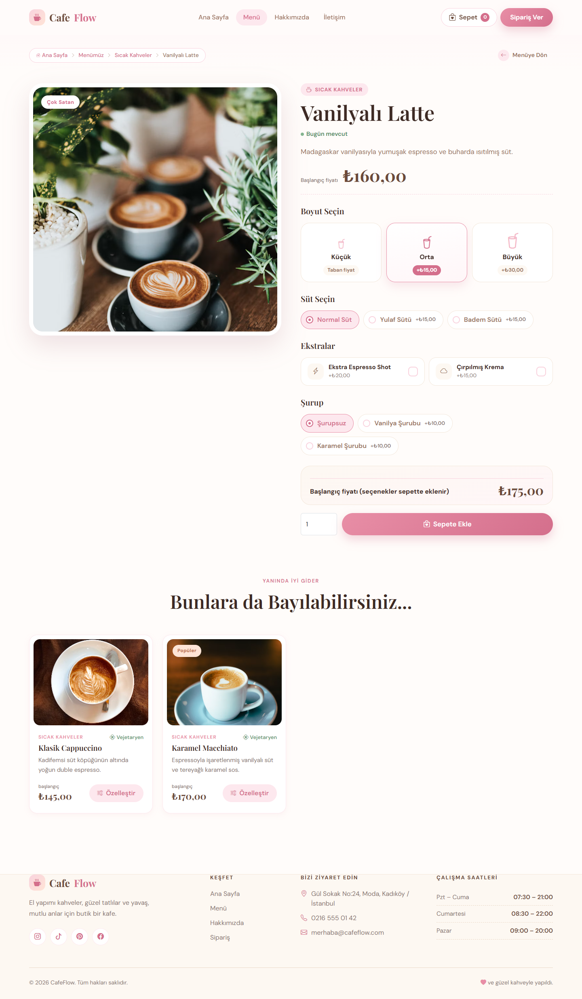 | 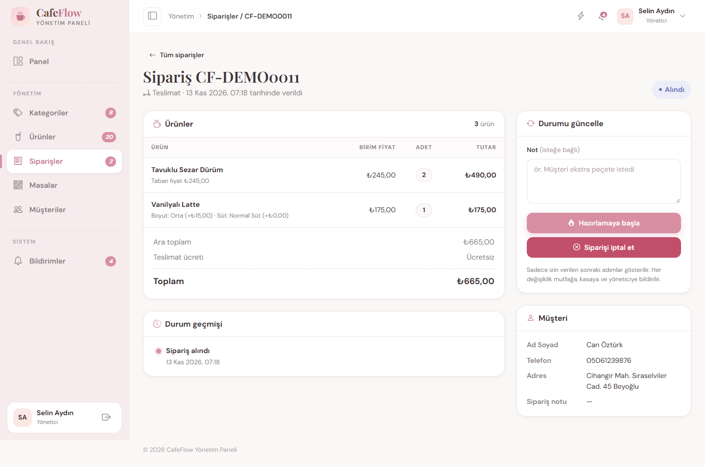 |
| 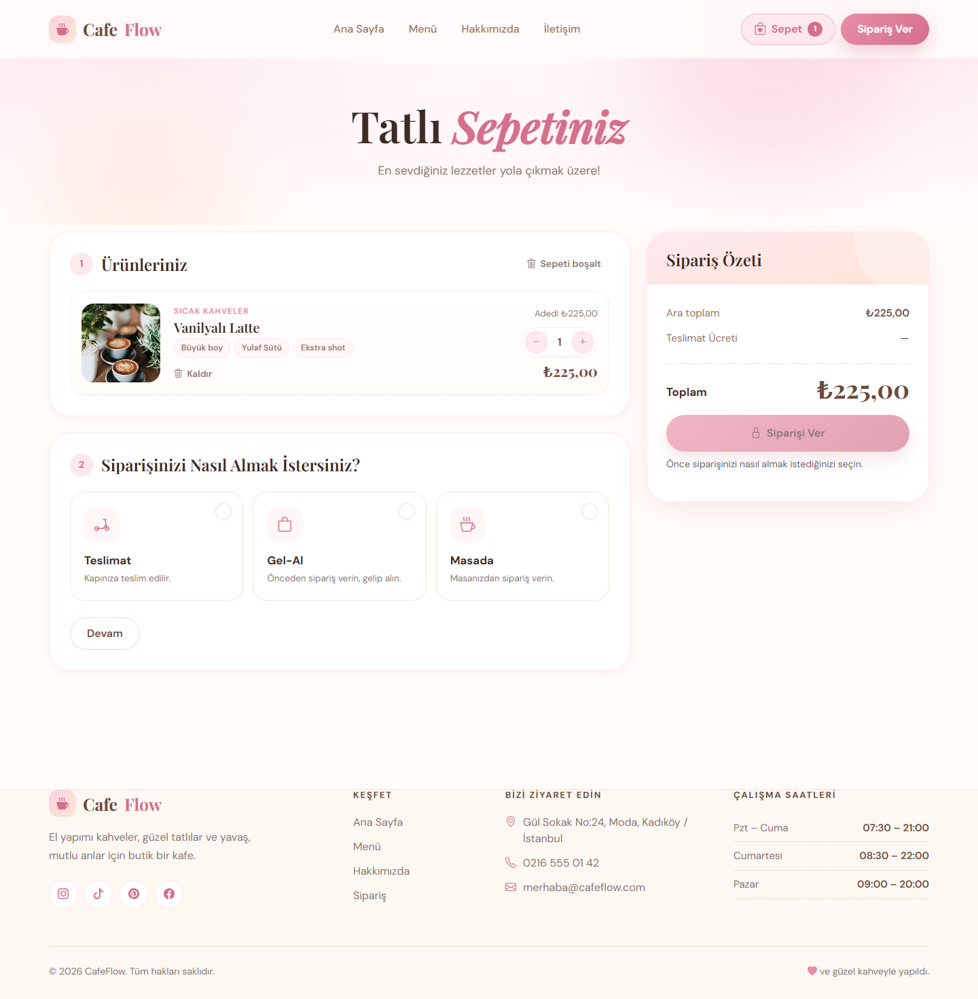 | 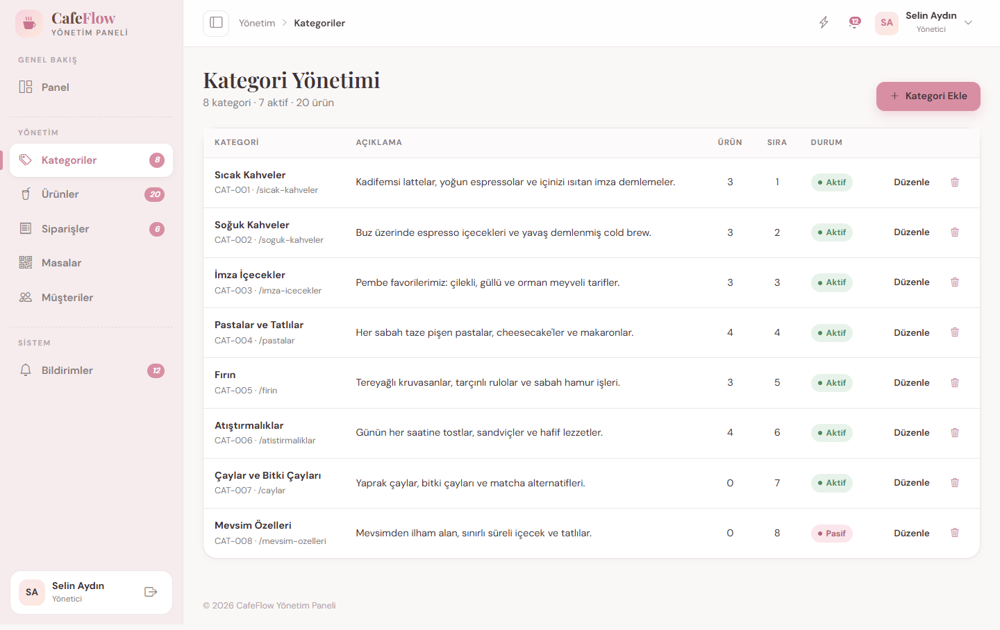 |
| 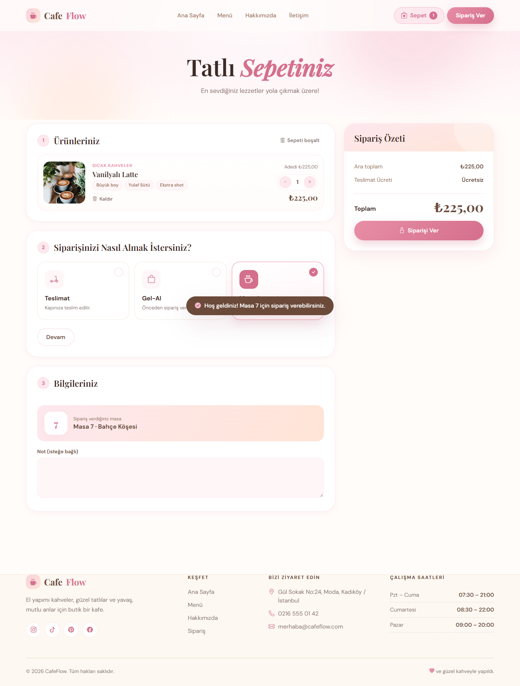 | 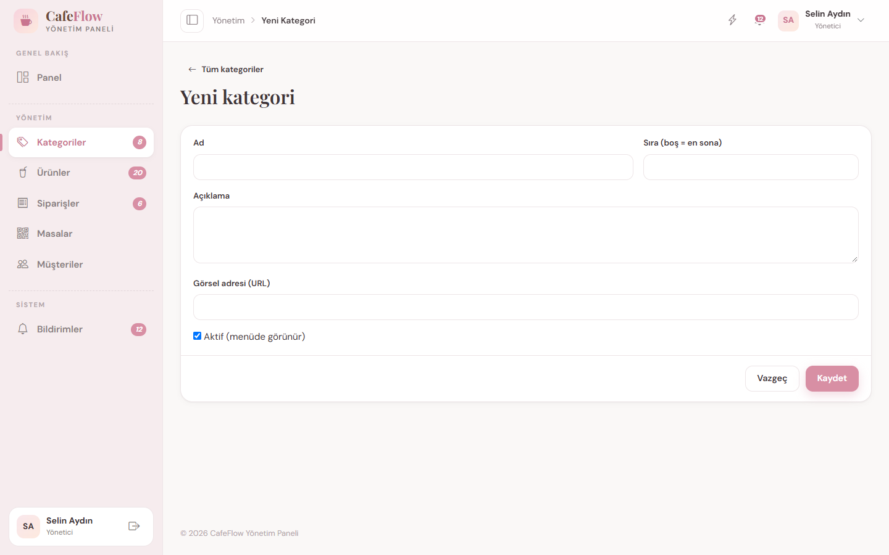 |
| 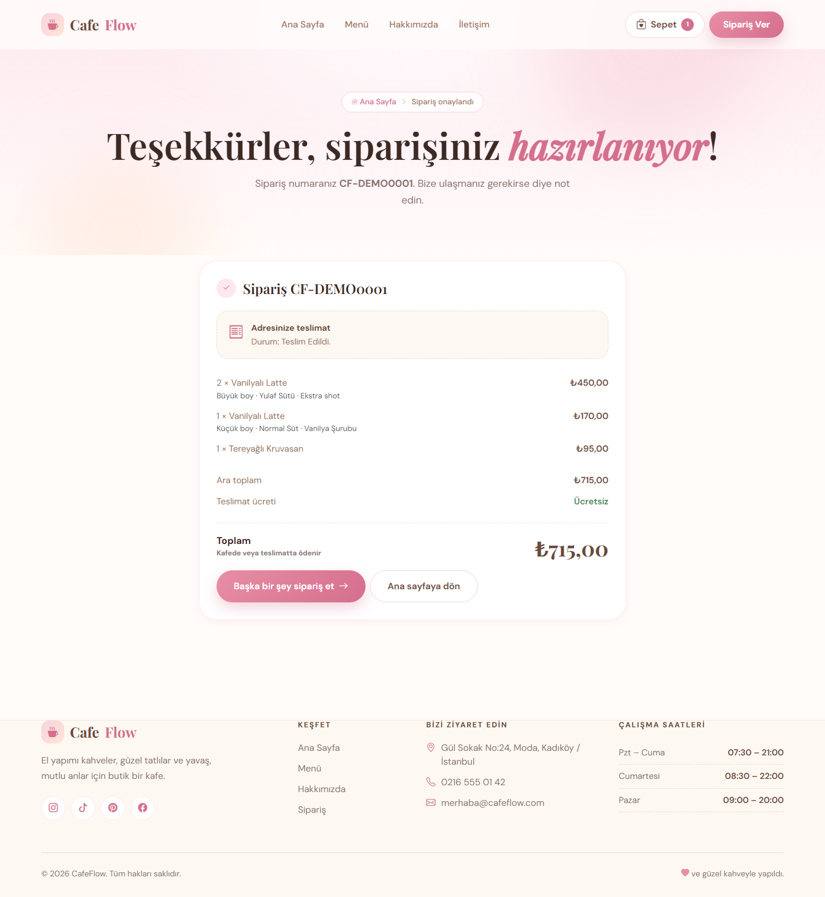 | 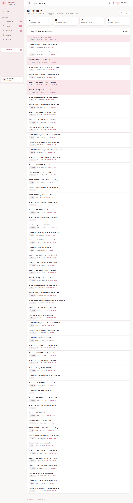 |

Diğerleri: [arama ve filtre](docs/screenshots/03-products-filter.png), [admin girişi](docs/screenshots/08-admin-login.png), [ürünler](docs/screenshots/14-admin-products.png), [masalar](docs/screenshots/15-admin-tables.png), [müşteriler](docs/screenshots/16-admin-customers.png).

## Kapsam Dışı

- Gerçek ödeme, kurye ve SMS entegrasyonu
- Müşteri hesabı ve müşteri girişi (müşteriler giriş yapmadan sipariş verir)
- Birden fazla admin hesabını panelden yönetme (ilk hesap kurulumda oluşturulur)
